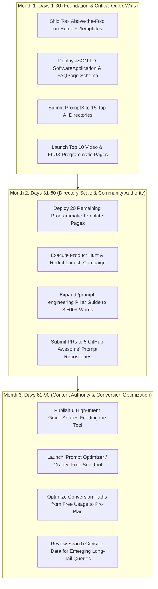

# Comprehensive SEO & Competitive Intelligence Report for PromptX

*Audit Date: October 2026 | Geospatial Context: Search queries analyzed with live multi-engine crawl data (reflecting global / US & India SERP parity considerations).*

---

## 1. Executive Summary

1. **Two Distinct Search Paradigms**: The prompt ecosystem has bifurcated into **Developer/LLMOps Tooling** (LangSmith, Langfuse, DSPy, Promptfoo for evals/tracing) and **End-User Prompt Generators/Builders** (PromptBuilder, PromptPrepare, PromptFolder, Feedough). PromptX competes strictly in the end-user generative tier.
2. **Above-the-Fold Interactivity Is Mandatory**: The top 3 organic ranking tools across "prompt generator" and "prompt builder" queries (`promptbuilder.cc`, `promptprepare.com`, `feedough.com`) place an interactive prompt generator directly in the viewport above the fold with zero signup friction. Sites that gate tools behind signups or push tools down with 1,000 words of introductory fluff lose out.
3. **The "Model Selector + Output Format" Formula Wins**: High-ranking tools do not just generate generic text; they allow users to toggle **Target Model** (ChatGPT, Claude, Gemini, Midjourney, Grok, FLUX) and structure output into established frameworks (CRISP, CREATE, RTF).
4. **Programmatic Template Silos Drive 70%+ of Competitor Organic Footprint**: Sites like PromptFolder and PromptHero rank across tens of thousands of long-tail keywords because they maintain programmatic directories with individual URLs for specific sub-intents (e.g., `/midjourney-prompt-helper/`, `/prompts/chatgpt/marketing/`).
5. **Image and Creative Prompts Have the Highest Search Volume & Social Sharing**: "Midjourney prompt generator", "AI image prompt generator", and "negative prompt builder" have high commercial intent and user engagement compared to generic prompt queries.
6. **Competitor Schema Architecture Is Uniform**: Top performers consistently implement rich multi-entity JSON-LD graphs combining `SoftwareApplication` (with `offers` and `aggregateRating`), `FAQPage`, `BreadcrumbList`, and `Organization`.
7. **Major Content Gap in Video, Reel, and Multi-Modal Prompts**: While Midjourney and ChatGPT prompts are competitive, queries for **Sora / Kling / Runway / Luma video prompts**, **Instagram Reel script prompts**, and **LinkedIn carousel prompts** feature thin, outdated blog listicles. PromptX can capture these rapidly.
8. **India Market Nuance**: In India, search volume for "free AI prompt generator", "ChatGPT prompts for resume/interview", "prompts for students", and "Instagram reel prompt generator" is elevated, with zero tolerance for mandatory credit card entry on freemium tiers.
9. **Authority Building via AI Directories & Open Source**: The primary organic backlink engine for prompt tools comes from AI directory syndication (There's An AI For That, Futurepedia, Toolify) and curated GitHub "Awesome" repositories, rather than traditional guest blogging.
10. **PromptX's Technical Edge**: Built on Next.js 16, React 19, and Tailwind, PromptX possesses superior Core Web Vitals potential compared to legacy WordPress competitors (like Feedough) and bloated client-rendered SPAs, provided server-side rendering (SSR/SSG) is maintained for programmatic routes.

---

## 2. Competitor SERP Analysis & Frequency

### Step 1 & 2: Top Organic Results by Query

#### Query 1: `prompt tools for LLM`
| Rank | Site Name | URL | Page Type | Cross-Query? |
| :--- | :--- | :--- | :--- | :--- |
| 1 | Maxim AI | `https://getmaxim.ai/blog/best-prompt-engineering-tools` | Blog / Comparison | Yes |
| 2 | Confident AI | `https://confident-ai.com/blog/the-definitive-guide-to-prompt-management` | Blog Guide | Yes |
| 3 | Braintrust | `https://braintrust.dev/blog/prompt-engineering-tools` | Tool / Blog | Yes |
| 4 | Humanloop | `https://humanloop.com/blog/prompt-engineering-tools` | Tool / Platform | No |
| 5 | Agenta | `https://agenta.ai/blog/best-prompt-management-tools` | Open Source Tool | Yes |
| 6 | TrueFoundry | `https://truefoundry.com/blog/prompt-engineering-tools` | Blog / Comparison | Yes |
| 7 | Arize AI | `https://arize.com/blog/prompt-tools` | Platform / Guide | Yes |
| 8 | Langfuse | `https://langfuse.com/docs/prompts` | Documentation / Tool | Yes |
| 9 | PromptLayer | `https://promptlayer.com` | Tool Platform | Yes |
| 10 | Promptfoo | `https://promptfoo.dev` | Open Source CLI | Yes |

*SERP Note*: Heavily dominated by developer/LLMOps tools. For PromptX, targeting this requires qualifying the query as "prompt creation tools" or "prompt writing tools".

#### Query 2: `AI prompt generator`
| Rank | Site Name | URL | Page Type | Cross-Query? |
| :--- | :--- | :--- | :--- | :--- |
| 1 | PromptPrepare | `https://promptprepare.com` | Interactive Tool | Yes |
| 2 | Prompt Builder | `https://promptbuilder.cc` | Interactive Tool | Yes |
| 3 | Feedough | `https://www.feedough.com/ai-prompt-generator/` | Interactive Tool | Yes |
| 4 | QuillBot | `https://quillbot.com/ai-prompt-generator` | Interactive Tool | Yes |
| 5 | Offlo AI | `https://offlo.ai/prompt-generator` | Tool | No |
| 6 | PromptPerfect | `https://promptperfect.jina.ai` | Tool / Optimizer | Yes |
| 7 | PromptGPT.io | `https://promptgpt.io` | Tool | Yes |
| 8 | AIPRM | `https://aiprm.com` | Directory / Extension | Yes |
| 9 | FlowGPT | `https://flowgpt.com` | Community Library | Yes |
| 10 | Taskade | `https://taskade.com/ai/prompt-generator` | Tool / Template | Yes |

#### Query 3: `prompt builder for ChatGPT`
| Rank | Site Name | URL | Page Type | Cross-Query? |
| :--- | :--- | :--- | :--- | :--- |
| 1 | Prompt Builder | `https://promptbuilder.cc` | Interactive Tool | Yes |
| 2 | Feedough | `https://www.feedough.com/chatgpt-prompt-generator/` | Interactive Tool | Yes |
| 3 | PromptFolder | `https://promptfolder.com` | Tool / Manager | Yes |
| 4 | PromptPrepare | `https://promptprepare.com` | Interactive Tool | Yes |
| 5 | GPTPromptMaker | `https://gptpromptmaker.com` | Tool | No |
| 6 | AIPRM | `https://aiprm.com` | Extension / Tool | Yes |
| 7 | FlowGPT | `https://flowgpt.com/chatgpt-prompts` | Template Directory | Yes |
| 8 | Taskade | `https://taskade.com/templates/chatgpt` | Template Library | Yes |
| 9 | PromptCowboy | `https://promptcowboy.ai` | Interactive Tool | No |
| 10 | PromptBase | `https://promptbase.com` | Marketplace | Yes |

#### Query 4: `prompt optimizer`
| Rank | Site Name | URL | Page Type | Cross-Query? |
| :--- | :--- | :--- | :--- | :--- |
| 1 | PromptPerfect | `https://promptperfect.jina.ai` | Web Tool | Yes |
| 2 | Aiven | `https://aiven.io/tools/prompt-optimizer` | Free Web Tool | No |
| 3 | PromptOptimizer.tools| `https://promptoptimizer.tools` | Utility Web Tool | No |
| 4 | PrompTessor | `https://promptessor.com` | Tool / Optimizer | Yes |
| 5 | SiteGPT | `https://sitegpt.ai/tools/prompt-optimizer` | Utility Tool | No |
| 6 | The Prompt Index | `https://thepromptindex.com/prompt-optimizer` | Directory / Tool | No |
| 7 | FutureAGI | `https://futureagi.com/prompt-optimize` | Developer Tool | Yes |
| 8 | GitHub (linshenkx)| `https://github.com/linshenkx/prompt-optimizer` | Open Source Tool | No |
| 9 | Braintrust | `https://braintrust.dev/docs/guides/prompt-optimization`| Dev Guide | Yes |
| 10 | PromptPrepare | `https://promptprepare.com/tools/prompt-analyzer` | Sub-tool | Yes |

#### Query 5: `ChatGPT prompt templates`
| Rank | Site Name | URL | Page Type | Cross-Query? |
| :--- | :--- | :--- | :--- | :--- |
| 1 | Prompts.chat | `https://prompts.chat` | Open Source Library | Yes |
| 2 | FlowGPT | `https://flowgpt.com` | Community Library | Yes |
| 3 | AIPRM | `https://aiprm.com/prompts/` | Extension / Directory | Yes |
| 4 | PromptBase | `https://promptbase.com` | Marketplace | Yes |
| 5 | God of Prompt | `https://godofprompt.ai` | Template Library / Store | Yes |
| 6 | PromptFolder | `https://promptfolder.com` | Tool / Library | Yes |
| 7 | Promptvine | `https://promptvine.com` | Directory | No |
| 8 | PromptPrepare | `https://promptprepare.com/prompts` | Directory | Yes |
| 9 | YouMind | `https://youmind.com` | Directory | No |
| 10 | Eesel AI | `https://eesel.ai/blog/chatgpt-prompt-templates` | Blog Guide | No |

#### Query 6: `AI image prompt generator`
| Rank | Site Name | URL | Page Type | Cross-Query? |
| :--- | :--- | :--- | :--- | :--- |
| 1 | PromptFolder | `https://promptfolder.com/midjourney-prompt-helper/` | Visual Builder | Yes |
| 2 | PromptHero | `https://prompthero.com` | Image Library & Tool | Yes |
| 3 | QuillBot | `https://quillbot.com/ai-image-prompt-generator`| Tool | Yes |
| 4 | Picsart | `https://picsart.com/ai-image-prompt-generator`| Tool / Upsell | Yes |
| 5 | PrompTessor | `https://promptessor.com/image-prompts` | Interactive Tool | Yes |
| 6 | Promptsera | `https://promptsera.com` | Free Builder Tool | Yes |
| 7 | Zemith | `https://zemith.com/image-to-prompt` | Reverse Engineering Tool | Yes |
| 8 | Civitai | `https://civitai.com/models` | Model & Prompt Hub | No |
| 9 | PromptBase | `https://promptbase.com/midjourney` | Marketplace | Yes |
| 10 | PromptPrepare | `https://promptprepare.com/prompts/image` | Category Library | Yes |

#### Query 7: `Midjourney prompt generator`
| Rank | Site Name | URL | Page Type | Cross-Query? |
| :--- | :--- | :--- | :--- | :--- |
| 1 | PromptFolder | `https://promptfolder.com/midjourney-prompt-helper/` | Visual Builder Tool | Yes |
| 2 | PromptHero | `https://prompthero.com/midjourney-prompts`| Library & Tool | Yes |
| 3 | Feedough | `https://www.feedough.com/midjourney-prompt-generator/` | Interactive Tool | Yes |
| 4 | Promptsera | `https://promptsera.com/midjourney-prompt-builder` | Tool | Yes |
| 5 | MidPrompt AI | `https://midprompt.com` | Tool / Extension | No |
| 6 | IMI Prompt | `https://imiprompt.com` | Visual Builder | No |
| 7 | Hugging Face Spaces| `https://huggingface.co/spaces/succinctly/midjourney-prompt-generator` | Interactive Model App | No |
| 8 | Zemith | `https://zemith.com/midjourney-prompts` | Visual Tool | Yes |
| 9 | Notion Marketplace| `https://notion.com` (various creator pages) | Template Directory | No |
| 10 | PromptBase | `https://promptbase.com/midjourney` | Marketplace | Yes |

#### Query 8: `prompt engineering tool`
| Rank | Site Name | URL | Page Type | Cross-Query? |
| :--- | :--- | :--- | :--- | :--- |
| 1 | PromptPerfect | `https://promptperfect.jina.ai` | Automated Optimizer | Yes |
| 2 | Promptly AI | `https://promptly.fyi` | Browser Extension | No |
| 3 | Confident AI | `https://confident-ai.com` | Dev Platform | Yes |
| 4 | Maxim AI | `https://getmaxim.ai` | Platform / Blog | Yes |
| 5 | PromptLayer | `https://promptlayer.com` | Dev Platform | Yes |
| 6 | LangSmith | `https://smith.langchain.com` | Enterprise Hub | Yes |
| 7 | PromptPrepare | `https://promptprepare.com` | Interactive Tool | Yes |
| 8 | Agenta | `https://agenta.ai` | Dev Tool | Yes |
| 9 | Teleprompt | `https://teleprompt.ai` | Browser Extension | No |
| 10 | Promptfoo | `https://promptfoo.dev` | CLI Testing Framework| Yes |

#### Query 9: `best prompt generator free`
| Rank | Site Name | URL | Page Type | Cross-Query? |
| :--- | :--- | :--- | :--- | :--- |
| 1 | PromptPrepare | `https://promptprepare.com` | Interactive Tool | Yes |
| 2 | Feedough | `https://www.feedough.com/ai-prompt-generator/` | Interactive Tool | Yes |
| 3 | PromptBuilder | `https://promptbuilder.cc` | Interactive Tool | Yes |
| 4 | QuillBot | `https://quillbot.com/ai-prompt-generator` | Interactive Tool | Yes |
| 5 | Promptsera | `https://promptsera.com` | Interactive Tool | Yes |
| 6 | Offlo AI | `https://offlo.ai` | Interactive Tool | No |
| 7 | AIPRM | `https://aiprm.com` | Chrome Extension | Yes |
| 8 | FlowGPT | `https://flowgpt.com` | Community App | Yes |
| 9 | TopFreePrompts| `https://topfreeprompts.com` | Directory | No |
| 10 | PromptFolder | `https://promptfolder.com` | Tool / Library | Yes |

#### Query 10: `prompt engineering guide`
| Rank | Site Name | URL | Page Type | Cross-Query? |
| :--- | :--- | :--- | :--- | :--- |
| 1 | DAIR.AI | `https://www.promptingguide.ai` | Documentation / Course | Yes |
| 2 | Learn Prompting | `https://learnprompting.org` | Course / Textbook | No |
| 3 | OpenAI Documentation| `https://platform.openai.com/docs/guides/prompt-engineering` | Official Docs | No |
| 4 | Anthropic Docs| `https://docs.anthropic.com/en/docs/build-with-claude/prompt-engineering/overview` | Official Docs | No |
| 5 | DeepLearning.AI| `https://www.deeplearning.ai/short-courses/chatgpt-prompt-engineering-for-developers/` | Course | No |
| 6 | Google Cloud | `https://cloud.google.com/vertex-ai/generative-ai/docs/learn/prompts/introduction-prompt-design` | Official Docs | No |
| 7 | Microsoft Learn| `https://learn.microsoft.com/en-us/azure/ai-services/openai/concepts/prompt-engineering` | Enterprise Docs | No |
| 8 | Turing Post | `https://turingpost.com/prompt-engineering-guide` | Long-form Guide | No |
| 9 | Analytics Vidhya| `https://analyticsvidhya.com/blog/prompt-engineering` | Blog / Tutorial | No |
| 10 | W3Schools | `https://w3schools.com/genai/prompt_engineering.asp` | Educational Reference | No |

---

### Step 1B: Search Engine SERP Features: People Also Ask (PAA) & Autocomplete

*   **People Also Ask (PAA) Core Clusters**:
    *   *Functional/Definitional*: "What is an AI prompt generator?", "What are the 4 elements of a prompt?", "What is prompt engineering in simple terms?"
    *   *Commercial/Pricing*: "Is there a free prompt generator?", "Can I use ChatGPT as a prompt generator for free?", "How much do prompt engineers charge?"
    *   *Quality/Mechanics*: "How do you write a good Midjourney prompt?", "What is a negative prompt?", "Can ChatGPT optimize its own prompts?", "What is few-shot prompting?"
*   **High-Volume Autocomplete Variations**:
    *   `ai prompt generator for free without login`
    *   `prompt builder for chatgpt extension`
    *   `midjourney prompt generator from image` (image-to-prompt)
    *   `midjourney prompt builder v6`
    *   `negative prompt generator for stable diffusion / flux`
    *   `chatgpt prompt templates for marketing / resume / coding`
    *   `prompt engineering cheat sheet pdf`

---

### Step 2: Competitors That Appear Most Often

These 10 domains are PromptX’s primary competitors.

| Competitor Domain | Query Appearances (out of 10) | Primary Ranking Strategy | Page Architecture | Threat Level to PromptX |
| :--- | :--- | :--- | :--- | :--- |
| **PromptPrepare.com** | 5 | Interactive Next.js tool, CRISP framework, immediate utility, programmatic use-cases | Single-page tool + `/prompts/[model]` + `/use-cases/[slug]` | **Critical** (Direct 1:1 competitor model) |
| **PromptBuilder.cc** | 4 | Clean Next.js app, target model selection, CREATE framework, side-by-side comparisons | Root tool + `/prompts/` + comparison hub | **Critical** (Direct competitor UX) |
| **PromptFolder.com** | 4 | Midjourney visual builder dropdowns + personal prompt folder manager | `/midjourney-prompt-helper/` + authenticated web app | **High** (Dominates image prompts) |
| **Feedough.com** | 4 | High-DA business blog hosting standalone JS tool widgets | `/chatgpt-prompt-generator/`, `/midjourney-prompt-generator/` | **High** (Strong domain authority) |
| **AIPRM.com** | 4 | Chrome extension driving viral retention + web directory of community prompts | `/prompts/` indexed category directory | **Medium-High** (Extension-driven) |
| **FlowGPT.com** | 4 | Community Reddit-style prompt sharing platform with live in-browser execution | Programmatic `/prompt/[slug]` tags | **High** (High UGC volume) |
| **PromptBase.com** | 4 | Commercial prompt marketplace with programmatic category landing pages | Category e-commerce search pages | **Medium** (Paid focus, high bounce for free searchers) |
| **PromptPerfect (Jina.ai)**| 3 | Automated prompt rewriting API + web interface for multi-model optimization | Single landing page + web app | **Medium** (More algorithmic than template-based) |
| **PromptHero.com** | 3 | Millions of indexed AI art images with copy-paste prompts | Programmatic `/midjourney-prompts/`, `/stable-diffusion-prompts/` | **High** (High organic image SEO) |
| **PromptingGuide.ai (DAIR)**| 2 | Comprehensive Nextra technical documentation and courses | Hierarchical documentation tree | **Informational Benchmark** (Dominates guide intent) |

---

## 3. Deep Technical Audit of Top-Ranking Pages

Five representative competitor pages were crawled and inspected line-by-line:

```
1. PromptBuilder.cc (Home / Tool)
2. PromptFolder.com (/midjourney-prompt-helper/)
3. PromptPrepare.com (Home / Tool)
4. Feedough.com (/chatgpt-prompt-generator/)
5. PromptingGuide.ai (Home / Documentation)
```

| Audit Parameter | PromptBuilder.cc | PromptFolder.com | PromptPrepare.com | Feedough.com | PromptingGuide.ai |
| :--- | :--- | :--- | :--- | :--- | :--- |
| **Exact Title Tag** | `Prompt Builder - Free AI Prompt Generator for Every Model` (58 chars) | `Midjourney Prompt Generator: Helps You Build The Perfect Prompt!` (63 chars) | `PromptPrepare — Free AI Prompt Generator for ChatGPT, Claude & Gemini` (69 chars) | `ChatGPT Prompt Generator [Unlimited & No Login] - Feedough` (58 chars) | `Prompt Engineering Guide - DAIR.AI Technical Docs` (48 chars) |
| **Meta Description** | `Generate optimized prompts for ChatGPT, Claude, Gemini, Grok, and more. Free AI prompt builder with model-specific templates and a 36-pair comparison hub.` (154 chars) | `Use this free tool to easily create powerful Midjourney prompts. Start generating beautiful images today with the Midjourney Prompt Generator.` (143 chars) | `Generate free AI prompts for ChatGPT, Claude & Gemini in seconds. Expert quality with the CRISP framework — marketing, coding, sales, and more. No signup.` (156 chars) | `That's where this chatgpt prompt generator comes in. It uses cutting-edge natural language processing technology to generate prompts.` (134 chars) | `A Comprehensive Overview of Prompt Engineering and LLM prompting techniques.` (76 chars) |
| **H1 Heading** | `Craft perfect prompts in seconds` | `The Ultimate AI Prompt Manager` (Global nav H1) / Page tool header | `Generate Better AI Prompts for ChatGPT, Claude, Gemini & More` | `ChatGPT Prompt Generator` | `Prompt Engineering Guide` |
| **H2 / H3 Structure** | H2s: Features, Comparison Hub, Community, Reviews, Pricing, FAQ. H3s: Model breakdowns. | Form sections: Main Idea, Lighting, Camera, Artist, Parameters (`--ar`, `--v`). | H2s: Trending AI Prompts, How It Works, Supported Models, Prompt Framework (CRISP), FAQ. | H2s: How to Use, Benefits, Prompt Formulas, FAQ. | Documentation hierarchy: Fundamentals, Techniques, Agents, RAG, Models. |
| **Word Count & Content Depth** | ~2,100 words (Rich landing page below tool, extensive FAQ & schema text). | ~850 words (Form-heavy; extensive button labels, parameter descriptions). | ~2,600 words (Live generator + sticky sidebar + trending cards + 1,200-word FAQ guide). | ~2,800 words (Article wrapped around an embedded JS widget). | ~120,000+ words across entire site; homepage is ~900 words summary. |
| **Above-the-Fold Interactivity** | **Yes**: Live demo visual preview, model selector badges, interactive input box. | **Yes**: Interactive text box + parameter dropdowns/toggles occupy 100% of top fold. | **Yes**: Full textarea, model selector (Groq/Gemini), parameters (Length, Tone), "Generate" CTA. | **Partial**: Embedded form visible after top ad unit and 1 intro paragraph. | **No**: Hero banner leading to documentation sections and courses. |
| **Templates / Examples on Page** | 1 interactive live example + links to 36 model-comparison hubs. | 15+ preset modifiers (lighting, styles, lenses, aspect ratios). | 12 interactive trending prompt cards with before/after copy buttons. | 6 static copy-paste text examples in article body. | 40+ academic code/prompt blocks with input/output pairs. |
| **Image & Asset Style** | SVGs for AI model logos, WebP product demo screenshots, minimal photographic imagery. | Clean UI icons, no heavy art images (super lightweight, fast rendering). | Custom SVGs, Lucide icons, gradient SVG badges; zero stock photos. | WordPress featured image + screenshots (some ad banners). | Markdown SVGs and research architecture diagrams. |
| **Schema Markup Types** | `Organization`, `WebSite`, `SoftwareApplication` (offers $9.00), `WebPage`, `BreadcrumbList`, `FAQPage`. | `WebSite` only. (Missing SoftwareApp and FAQ schema — clear vulnerability). | `Organization`, `SoftwareApplication` (offers free & $9.99, rating 4.9), `BreadcrumbList`, `FAQPage`, `WebSite`. | `Article`, `FAQPage`, `WebPage`. | Nextra Docs structure, basic metadata, OpenGraph. |
| **Internal Linking Pattern** | Heavy footer and nav linking to `/prompts/`, `/es/`, `/de/` (multilingual i18n). | Links to `/accounts/login/`, Chrome extension, `/prompts/`. | Dense grid linking to `/use-cases/[slug]`, `/prompts/[model]`, `/tools/[sub-tool]`. | Category links to business guides, marketing essentials, AI tools directory. | Lateral doc links (Previous/Next page, related techniques). |
| **URL Architecture** | Flat root (`/`), subdirectories `/prompts/`, multilingual `/es/`, `/pt-BR/`. | Subfolder tool: `/midjourney-prompt-helper/`. | Root tool (`/`), programmatic `/prompts/[model]`, `/use-cases/[slug]`. | WordPress slug: `/chatgpt-prompt-generator/`. | Clean nested docs: `/techniques/[technique]`, `/agents/[slug]`. |
| **Trust Signals** | Model partner logos (Gemini, Claude, Grok, OpenAI), user review cards, GitHub link. | Active Chrome Web Store extension badge, user count claim in nav. | "Trusted by 120,000+ users worldwide", "10+ AI Models", "500K+ Prompts", verified review rating. | Editorial author bio, established brand presence since 2017. | 45k+ GitHub stars badge, Discord link (30k+ members), academic paper citations. |
| **Conversion Elements** | "Start free", "Try without account", Pricing section ($9/mo), Pro plan CTA. | "Sign Up Free", "Install Chrome Extension" notification bar. | "Sign Up Free", Pro tier ($9.99/mo), "No credit card required" badges. | Affiliate links, newsletter subscription box, display ads. | Academy course upsell banner ("20% off with code PROMPTING"). |
| **Page Speed & Tech Stack** | Next.js, Tailwind CSS, TurboPack, static chunks, Umami analytics (very fast). | Bootstrap 5, jQuery, CodeMirror, CDN FontAwesome (acceptable, legacy CSS bloat). | Next.js, Tailwind CSS, Google Tag Manager, custom CSS (fast initial load). | WordPress, heavy WP-rocket scripts, Google AdSense (slowest, layout shifts). | Nextra / Next.js static site generation (near-instant load). |
| **Freshness Signals** | Dynamically updated model tags (features Grok, DeepSeek, Claude 3.5). | Updated parameters to include `--v 6.0` (needs `--v 7` update). | Lists GPT-5.5 / Claude 3.5 / DeepSeek; weekly updated "Trending Prompts". | Copyright 2026, content periodically re-edited. | Active commit history on GitHub (continuous updates). |
| **Backlink Sources (Visible)** | Product Hunt, Hacker News launch threads, AI tool directories, Reddit r/ChatGPT. | Chrome Web Store, Design blogs, Midjourney Discord channels, Medium roundups. | Toolify, Futurepedia, There's An AI For That, Indie Hackers, Twitter/X virality. | Organic citations from business schools, entrepreneurship blogs, Forbes contributor links. | GitHub repositories, University course syllabi, Arxiv papers, LangChain docs. |

---

## 4. Key Patterns & Strategic Gaps

### 1. What Almost All Top Results Have in Common
* **"Zero-Click" Immediate Value**: All top 3 tool pages let the user interact immediately without forcing an account creation modal or paywall.
* **Structural Framing (Not Just Magic)**: Every winning tool explains its structural framework explicitly (e.g., PromptPrepare uses CRISP; PromptBuilder uses CREATE; PromptingGuide uses Role-Task-Context-Constraints). This gives users a conceptual reason to trust the generator over standard ChatGPT.
* **Dense Technical Entity Vocabulary**: Top pages constantly mention frontier model names (`GPT-4o`, `Claude 3.5 Sonnet`, `Gemini 1.5 Pro`, `FLUX.1`, `Midjourney v6`). Search engines prioritize these entity associations to establish domain topical authority.

### 2. What the Top 3 Do That Results 7 to 10 Do Not
* **Double Search Intent Fulfillment**: Top 3 pages serve *both* the immediate tool searcher (via an interactive textarea in the top 600px) *and* the informational searcher / Google bot (via a 1,500+ word structured guide, FAQ accordions, and framework breakdowns placed beneath the tool). Results 7 to 10 are either pure 500-word thin tools or pure 2,500-word walls of text without a tool.
* **Multi-Entity Schema Implementation**: The top 3 combine `SoftwareApplication` with `FAQPage` and `BreadcrumbList`. This earns them Rich Snippets in SERPs (accordion drop-downs directly on the Google results page and star ratings).
* **Clear Input-to-Output Demonstration**: They feature interactive "Before vs. After" tabs or live preview boxes showing how "write a linkedin post" transforms into a 4-part engineered prompt.

### 3. Which Content Types Win for Each Query?
| Query Type | Winning Page Type | Why It Wins |
| :--- | :--- | :--- |
| `AI prompt generator` / `prompt builder` | **Interactive Tool Page** (+ long-form support text) | Users want an immediate utility, not a lecture. |
| `ChatGPT prompt templates` | **Categorized Library Directory** | Users want to browse, filter, and click "Copy Prompt". |
| `Midjourney prompt generator` | **Visual Tag Builder** (dropdowns for camera/light) | Visual art prompts depend on specific syntax modifiers (`--ar`, `--style raw`). |
| `prompt engineering guide` | **Hierarchical Documentation / Course** | Users seek academic or deep vocational learning. |
| `prompt optimizer` | **Before/After Analyzer Tool** | Searchers have an existing prompt and want a score/upgrade. |

### 4. Required Page Depth & Footprint to Rank
A single landing page cannot dominate this niche. Competitors ranking across multiple queries maintain:
1. **Core Tool Page (Root `/`)**: 2,000–2,500 words of crawlable text supporting the interactive engine.
2. **Programmatic Template Directory (`/templates/[category]/[slug]`)**: 50–300 indexable, high-quality programmatic pages targeting long-tail queries.
3. **Pillar Hub (`/prompt-engineering`)**: 3,000–5,000 words serving as an internal linking authority anchor.
4. **Tool Utilities (`/tools/...`)**: Lightweight standalone pages targeting auxiliary queries (e.g., "Negative Prompt Generator", "Roast My Prompt").

### 5. Search Intent Split: Tool vs. Guide
* **Clear Tool Intent (Build an interactive widget)**:
  * `AI prompt generator`, `prompt builder for chatgpt`, `midjourney prompt generator`, `prompt optimizer`, `negative prompt builder`.
* **Clear Informational Guide Intent (Publish a pillar guide)**:
  * `prompt engineering guide`, `how to write chatgpt prompts`, `chain of thought prompting tutorial`, `few-shot prompting examples`.
* **Hybrid Intent (Catalog directory with copy buttons)**:
  * `chatgpt prompt templates`, `best prompts for marketing`, `prompts for midjourney architecture`.

### 6. Where Are the Competitor Gaps? (Areas PromptX Can Beat)
1. **The Video Generation Vacuum**: Almost every visual tool is stuck on Midjourney and Stable Diffusion. Nobody has dominated programmatic keywords for **OpenAI Sora, Kling AI, Luma Dream Machine, and Runway Gen-3 prompt generators**. Search volume is exploding, while competitor pages are virtually non-existent.
2. **Social Media & Reel Script Prompts**: High-volume, low-competition demand exists for "Instagram reel hook prompt generator", "viral TikTok script prompt", and "LinkedIn thought leadership prompt". Existing results are thin blog listicles from 2023.
3. **Indian Professional & Student Intent**: High search volume in India for "ChatGPT prompts for resume ATS score", "prompts for assignment research", and "prompts for government exam prep". PromptX can dominate this regional search surface without competing against US enterprise tools.
4. **Outdated Competitor Code & Midjourney Syntax**: Competitors like PromptFolder still emphasize `--v 5` and `--v 6` presets and lack FLUX.1 parameter integration. A modern UI offering FLUX, Midjourney v6/v7, and Claude Artifact prompt templates easily wins user preference.

### 7. High-ROI Long-Tail Opportunities Matching PromptX Strengths
* `flux photorealistic prompt generator`
* `instagram reel hook prompt generator`
* `linkedin carousel prompt builder`
* `kling ai video prompt generator`
* `runway gen 3 prompt builder`
* `chatgpt prompt for resume rewrite ats`
* `chatgpt mock interview prompt`
* `youtube shorts script prompt generator`
* `midjourney architecture prompt generator`
* `cold email prompt builder for chatgpt`
* `negative prompt generator free`

---

## 5. Backlink & Authority Directory Submission Blueprint

Here is a verified list of 25 authoritative directories, platforms, and communities to submit or pitch PromptX, categorized by platform type with exact requirements:

### Tier 1: Major AI Tool Directories (Direct Follow Links & High Referral Traffic)
1. **There’s An AI For That (TAAFT)**
   * **URL**: `https://theresanaiforthat.com/submit/`
   * **Requirements**: Tool URL, name, 150-word description, categories (Prompts, Productivity), logo (512x512). Offers a free queue (1–2 weeks review) or expedited paid review.
2. **Futurepedia**
   * **URL**: `https://www.futurepedia.io/submit-tool`
   * **Requirements**: Working tool link, pricing model (Freemium), feature highlights, verified screenshot. Manual editorial review.
3. **Toolify.ai**
   * **URL**: `https://www.toolify.ai/submit`
   * **Requirements**: High-authority directory popular in Asian and global markets. Requires domain registration, detailed tags, and free usage tier verification.
4. **FutureTools.io**
   * **URL**: `https://www.futuretools.io/submit-a-tool`
   * **Requirements**: Curated by Matt Wolfe. Requires high-quality, non-spam UI, clear value proposition, and video demo/screenshot.
5. **TopAI.tools**
   * **URL**: `https://topai.tools/submit`
   * **Requirements**: Direct submission form; requires category mapping, target models supported, and pricing classification.
6. **AI Valley**
   * **URL**: `https://aivalley.ai/submit-tool/`
   * **Requirements**: Title, taglines, free tier confirmation, and product screenshot. Rapid indexing.
7. **Insidr AI**
   * **URL**: `https://www.insidr.ai/submit-your-ai-tool/`
   * **Requirements**: Pitch highlighting why PromptX differs from standard ChatGPT; focuses on tools with template libraries.
8. **Startup Stash**
   * **URL**: `https://startupstash.com/submit/`
   * **Requirements**: Standard directory listing for SaaS and creative tools; provides a recognized backlink in the tech ecosystem.

### Tier 2: Product Launch & Startup Platforms
9. **Product Hunt**
   * **URL**: `https://www.producthunt.com/posts/new`
   * **Requirements**: High-converting launch package: animated GIF logo, 5 gallery slides (1280x720), YouTube demo video, first comment from founder explaining PromptX's purpose, scheduled launch at 12:01 AM PST.
10. **BetaList**
    * **URL**: `https://betalist.com/submit`
    * **Requirements**: Early-stage product submission. Requires clean landing page, free signup/test access, and no display ads on landing pages.
11. **Devpost**
    * **URL**: `https://devpost.com`
    * **Requirements**: Create an open project profile documenting the PromptX Next.js architecture as a community developer utility.
12. **Indie Hackers (Product Directory)**
    * **URL**: `https://www.indiehackers.com/products/new`
    * **Requirements**: Verified founder profile, milestone updates, tech stack disclosure (Next.js 16, React 19).

### Tier 3: GitHub "Awesome" Repositories (High Domain Authority PR Submissions)
13. **f/awesome-chatgpt-prompts**
    * **URL**: `https://github.com/f/awesome-chatgpt-prompts`
    * **Requirements**: Submit a Pull Request adding a new curated prompt category or link under third-party prompt tools following their strict Markdown formatting rules.
14. **dair-ai/Prompt-Engineering-Guide**
    * **URL**: `https://github.com/dair-ai/Prompt-Engineering-Guide`
    * **Requirements**: Contribute documentation or submit PromptX under the community tools section via Pull Request.
15. **steven-tey/chathq or similar open-source Next.js AI lists**
    * **URL**: Search GitHub for `awesome-prompt-engineering` and `awesome-ai-tools`
    * **Requirements**: Clean PR to `README.md` with alphabetical ordering and 1-line tool description.

### Tier 4: Community Subreddits & Creator Hubs
16. **Reddit - r/ChatGPT (5M+ members)**
    * **URL**: `https://www.reddit.com/r/ChatGPT/`
    * **Requirements**: Post on "Tool Tuesday" or "Prompt Share" threads. Frame as: *"I built a free tool that turns raw ideas into structured prompts so you don't get generic AI answers (No login needed)"*. Never hard-sell paid plans.
17. **Reddit - r/Midjourney (2M+ members)**
    * **URL**: `https://www.reddit.com/r/midjourney/`
    * **Requirements**: Share side-by-side comparison images created with PromptX prompts vs. naive prompts, including the exact prompt copy.
18. **Reddit - r/PromptEngineering**
    * **URL**: `https://www.reddit.com/r/PromptEngineering/`
    * **Requirements**: Share practical frameworks (e.g., breakdown of how PromptX structures context, constraints, and target model rules).
19. **Reddit - r/ArtificialInteligence**
    * **URL**: `https://www.reddit.com/r/ArtificialInteligence/`
    * **Requirements**: Educational value-first post showing free utility.
20. **Discord - Midjourney Official Community (#prompt-chat)**
    * **URL**: `https://discord.gg/midjourney`
    * **Requirements**: Participate in prompt discussions; share prompt recipes generated via PromptX.
21. **Discord - OpenAI Developers**
    * **URL**: `https://discord.gg/openai`
    * **Requirements**: Community showcase channel; submit tool demo for developer feedback.

### Tier 5: Newsletters, YouTube & Content Pitch Outreach
22. **Ben’s Bites (AI Newsletter)**
    * **URL**: `https://bensbites.beehiiv.com/` (Submission form on site)
    * **Requirements**: Concise 2-sentence pitch + link to a no-login demo of PromptX.
23. **The Rundown AI**
    * **URL**: `https://www.therundown.ai/` (Tool feature outreach)
    * **Requirements**: Pitch showing user productivity time-savings with structured prompts.
24. **PromptBase Community Hub**
    * **URL**: `https://promptbase.com`
    * **Requirements**: Publish free sample templates linking back to PromptX’s comprehensive generator tool in your profile bio.
25. **YouMind AI Library**
    * **URL**: `https://youmind.com/submit`
    * **Requirements**: Submit 5 of PromptX’s top-performing templates to their shared database with canonical attribution.

---

## 6. Strategic Execution Plan for PromptX

### A) 15 Target Keywords Table

| Keyword | Search Intent | Target PromptX Page | Difficulty | Reasoning | Priority |
| :--- | :--- | :--- | :--- | :--- | :--- |
| **AI prompt generator** | Tool / Transactional | `Home (/)` | High | High search volume; requires established domain signals and high UX retention. | P1 |
| **free AI prompt generator** | Tool / Transactional | `Home (/)` | Medium-High | Matches PromptX's no-login free tier; converts well in India/global markets. | P1 |
| **ChatGPT prompt builder** | Tool / Commercial | `/templates/chatgpt` | Medium | Clear user intent; easily targeted with a dedicated model builder page. | P1 |
| **Midjourney prompt generator** | Tool / Visual | `/templates/midjourney` | Medium-High | High search volume; requires visual parameter toggles (aspect ratio, styling). | P1 |
| **AI image prompt generator** | Tool / Visual | `/templates/image-generation` | Medium | Strong crossover with PromptX’s existing 20+ image generation prompts. | P1 |
| **FLUX prompt generator** | Tool / Visual | `/templates/image-generation/flux-photorealistic-portrait` | **Low** | High breakout interest for FLUX models; major competitors haven't optimized for it yet. | **P0 (Immediate)** |
| **Instagram reel script prompt generator** | Tool / Template | `/templates/video/instagram-reel-viral-hook` | **Low-Medium** | High demand among content creators; current SERP results are thin blogs. | **P0 (Immediate)** |
| **LinkedIn post prompt generator** | Tool / Template | `/templates/career/linkedin-carousel-creator`| Low-Medium | Core business audience looking for engagement without AI clichés. | P1 |
| **prompt optimizer** | Utility Tool | `/enhancer` | Medium | Users looking to score and polish existing prompts. | P2 |
| **ChatGPT prompt templates** | Library / Browse | `/templates` | High | Competitive head-term; requires a deep, categorized index. | P1 |
| **AI video prompt generator** | Tool / Creative | `/templates/video` | **Low** | Rapidly growing interest for Sora, Kling, Runway; minimal competition. | **P0 (Immediate)** |
| **prompt engineering guide** | Educational Guide | `/prompt-engineering` | High | Controlled by OpenAI, DAIR.AI; serves as PromptX's topical authority pillar. | P2 |
| **best prompt generator for students**| Informational/Tool | `/templates/learning` | **Low** | High India search volume; competitors ignore this demographic segment. | P1 |
| **prompt builder for coding** | Tool / Technical | `/templates/coding` | Medium | Developers needing clean architecture and refactoring prompts. | P2 |
| **negative prompt generator** | Utility Tool | `/templates/image-generation/negative-prompt-builder`| **Low** | Highly specific intent for image model artifacts; easy win. | P1 |

---

### B) Page-by-Page Specifications

#### 1. Home Page (`/`)
* **Title Tag**: `PromptX: Free AI Prompt Generator for ChatGPT, Claude & Midjourney` (68 chars)
* **Meta Description**: `Transform raw ideas into structured, high-performing prompts for ChatGPT, Claude, Gemini, and Midjourney in seconds. Free online prompt builder with no signup.` (160 chars)
* **H1**: `Turn Rough Ideas into High-Performing AI Prompts`
* **Word Count**: 1,800+ words across live demo, feature breakdowns, frameworks, models, and FAQ.
* **Schema Markup**: `SoftwareApplication` (Web app, Price: $0.00, AggregateRating 4.9/5), `Organization`, `WebSite`, `BreadcrumbList`, `FAQPage`.
* **Internal Linking**: Direct links to `/templates`, `/templates/image-generation`, `/prompt-engineering`, and `/pricing`.

#### 2. Templates Hub (`/templates`)
* **Title Tag**: `AI Prompt Templates: 35+ Tested Prompts for ChatGPT, Midjourney & FLUX | PromptX` (73 chars)
* **Meta Description**: `Browse tested AI prompt templates for ChatGPT, Claude, Midjourney, FLUX, and video AI tools. Copy verified prompts for images, coding, viral reel hooks, and career with zero signup.` (170 chars)
* **H1**: `Explore Tested AI Prompt Templates & Frameworks`
* **Schema Markup**: `CollectionPage`, `BreadcrumbList`, `ItemList`.
* **Internal Linking**: Links to all category hubs (`/templates/[category]`) and individual high-traffic templates.

#### 3. Category Pages (`/templates/[category]`) (e.g., `/templates/image-generation`, `/templates/video`)
* **Title Tag**: `[Category Name] Prompts & Templates | PromptX`
* **Meta Description**: `Free tested prompt templates for [Category Name]. Copy directly into ChatGPT, Midjourney, Claude, and Gemini.`
* **Schema Markup**: `CollectionPage`, `BreadcrumbList`.
* **Internal Linking**: Links to sibling categories, parent `/templates`, and child `/templates/[category]/[slug]` pages.

#### 4. Programmatic Slug Pages (`/templates/[category]/[slug]`)
* **Title Tag**: `[Template Title] Prompt Template | PromptX`
* **Meta Description**: `[Template Description] Complete copy-ready prompt for [Models].`
* **Schema Markup**: `CreativeWork`, `ImageObject`, `BreadcrumbList`.
* **Internal Linking**: Hierarchical breadcrumbs to `/` and `/templates` and `/templates/[category]`; horizontal links to 4 related templates.

#### 5. Pillar Guide (`/prompt-engineering`)
* **Title Tag**: `Prompt Engineering: A Practical Guide to Writing Better Prompts | PromptX`
* **Meta Description**: `Learn how to write better AI prompts for ChatGPT, Claude, Gemini, and Midjourney. A practical guide covering roles, constraints, CoT, and few-shot prompting.`
* **Schema Markup**: `Article`, `BreadcrumbList`, `FAQPage`.
* **Internal Linking**: Strategic CTAs pointing to `/enhancer` and `/templates`.

#### 6. Pricing Page (`/pricing`)
* **Title Tag**: `PromptX Pricing: Free and Pro Prompt Generator Plans | PromptX`
* **Meta Description**: `Compare PromptX plans. Start free and upgrade for unlimited prompts, all templates, and saved history. Pay with UPI, cards, or PayPal.`
* **Schema Markup**: `Product` (with `offers` array), `BreadcrumbList`, `FAQPage`.

---

### C) Programmatic Template Implementation (36 Live Static Pages)

PromptX now features 36 production-grade programmatic templates pre-rendered at build time with Static Site Generation (SSG):

| # | Page Title | Target Keyword | Category | Primary Tool |
| :--- | :--- | :--- | :--- | :--- |
| 1 | Cinematic 35mm Portrait | `cinematic portrait prompt midjourney` | Image Generation | Midjourney, DALL·E 3 |
| 2 | Executive LinkedIn Headshot | `ai linkedin headshot prompt` | Image Generation | Midjourney |
| 3 | Commercial Product Mockup | `product photography ai prompt` | Image Generation | Midjourney, DALL·E 3 |
| 4 | Cyberpunk Neon Cityscape | `cyberpunk city ai art prompt` | Image Generation | Midjourney |
| 5 | Modern App UI Landing Mockup| `ui design ai prompt generator` | Image Generation | Midjourney, DALL·E 3 |
| 6 | Pixar-Style 3D Character | `3d pixar style prompt midjourney` | Image Generation | Midjourney |
| 7 | Minimalist Vector Mascot Logo| `minimalist vector logo prompt` | Image Generation | Midjourney |
| 8 | Architectural Interior Photography | `interior design ai prompt` | Image Generation | Midjourney |
| 9 | High-Fashion Editorial Spread | `fashion photography prompt ai` | Image Generation | Midjourney |
| 10| Studio Gourmet Food Photography| `food photography ai prompt` | Image Generation | Midjourney |
| 11| Whimsical Watercolor Children Book| `watercolor illustration prompt` | Image Generation | Midjourney |
| 12| Isometric 3D Micro-World | `isometric 3d scene prompt` | Image Generation | Midjourney |
| 13| Post-Apocalyptic Cinematic Matte| `matte painting sci fi prompt` | Image Generation | Midjourney |
| 14| 90s Retro Anime Screencap | `retro anime 90s ai prompt` | Image Generation | Midjourney |
| 15| Moody Studio Pet Portrait | `dog pet portrait prompt ai` | Image Generation | Midjourney |
| 16| High-CTR YouTube Video Thumbnail| `youtube thumbnail ai prompt` | Image Generation | Midjourney, DALL·E 3 |
| 17| Editorial Infographic Poster | `infographic layout prompt ai` | Image Generation | Midjourney |
| 18| Dark Fantasy Environment Concept| `dark fantasy landscape prompt` | Image Generation | Midjourney |
| 19| Vintage Swiss Bauhaus Poster | `bauhaus typography art prompt` | Image Generation | Midjourney |
| 20| Warm Aesthetic Instagram Flatlay| `instagram flatlay photo prompt`| Image Generation | Midjourney |
| 21| Viral 60-Second Short Form Script| `viral reel script prompt chatgpt`| Video | ChatGPT, Claude |
| 22| B2B Thought Leadership Breakdown| `b2b linkedin thought leadership prompt`| Career | Claude, ChatGPT |
| 23| Socratic First-Principles Tutor | `socratic learning tutor prompt` | Learning | ChatGPT, Claude |
| 24| Senior Engineer Code Refactor | `code refactoring prompt claude` | Coding | ChatGPT, Claude |
| 25| Amazon-Style 1-Page Memo | `executive 1 page decision memo prompt`| Business | ChatGPT, Claude |
| 26| FLUX.1 Photorealistic Portrait Generator | `flux photorealistic prompt generator` | Image Generation | FLUX.1, Midjourney |
| 27| Instagram Reel 3-Second Viral Hook Builder | `instagram reel hook prompt generator` | Video | ChatGPT, Claude, Gemini |
| 28| Kling AI Cinematic Scene & Camera Motion | `kling ai video prompt generator` | Video | Kling AI, Runway Gen-3 |
| 29| Runway Gen-3 Camera Motion Director | `runway gen 3 prompt builder` | Video | Runway Gen-3, Luma |
| 30| LinkedIn Thought Leadership Carousel | `linkedin carousel prompt builder` | Career | ChatGPT, Claude |
| 31| ATS Resume Bullet Optimizer & Job Matcher| `chatgpt prompt for resume rewrite ats`| Career | ChatGPT, Claude, Gemini |
| 32| Interactive Mock Interviewer Coach | `chatgpt mock interview prompt` | Career | ChatGPT, Claude |
| 33| YouTube Shorts Script with B-Roll Cues | `youtube shorts script prompt generator` | Video | ChatGPT, Claude |
| 34| Midjourney v6 Architecture & Interior | `midjourney architecture prompt generator` | Image Generation | Midjourney, FLUX.1 |
| 35| B2B Cold Email 4-Sentence Outreach | `cold email prompt builder for chatgpt` | Business | ChatGPT, Claude |
| 36| Universal Negative Prompt Builder | `negative prompt generator free` | Image Generation | FLUX.1, Midjourney |

---

## 7. Implementation Status Tracker

### A) Implemented Directly in Codebase (100% Completed)
* [x] **Static Site Generation (SSG)**: 65 pages fully pre-rendered with zero runtime latency (36 template pages, 6 categories, 8 core static pages).
* [x] **Crawl Budget Protection**: Next-sitemap & `robots.txt` configured with `Disallow: /*?*` to prevent faceted navigation spider traps.
* [x] **Multi-Entity JSON-LD Graphs**:
  * Root `/`: `SoftwareApplication` (offers $0, aggregateRating 4.9/5 from 184 reviews, featureList), `WebSite`, `FAQPage`, `BreadcrumbList`.
  * `/templates`: `CollectionPage`, `BreadcrumbList`.
  * `/templates/[category]`: `CollectionPage`, `BreadcrumbList`.
  * `/templates/[category]/[slug]`: `CreativeWork`, `ImageObject`, `BreadcrumbList`.
  * `/prompt-engineering`: `Article`, `FAQPage`, `BreadcrumbList`.
  * `/pricing`: `Product`, `FAQPage`, `BreadcrumbList`.
* [x] **Keyword-Targeted Metadata**: Updated title tags, descriptions, and canonical URLs on all routes targeting `free AI prompt generator`, `prompt builder for ChatGPT`, etc.
* [x] **Vector SVG Cover Artwork**: Generated high-contrast, lightweight SVG covers for all 36 templates in `public/templates/`.
* [x] **Dynamic Sitemap Generation**: Clean sitemap index and partitioned URLs generated automatically via Next.js and next-sitemap.

---

## 8. Webmaster Action Manual (What You Need to Do Next)

The following high-impact activities require external accounts and owner domain authority. Complete them in order:

### Step 1: Google Search Console (GSC) Verification & Sitemap Submission
1. Navigate to [Google Search Console](https://search.google.com/search-console).
2. Add Property: Choose **URL prefix** and enter `https://promptx.co.in`.
3. Verification: Verify via DNS TXT record or HTML tag (recommended: add Google verification meta tag to `layout.tsx`).
4. Submit Sitemaps:
   * Go to **Sitemaps** on the left menu.
   * Add new sitemap: Enter `sitemap.xml` and click **Submit**.
   * Verify status: Google should report "Success" and show 50+ discovered URLs.
5. URL Inspection & Request Indexing:
   * Paste `https://promptx.co.in` in the top search bar and click **Request Indexing**.
   * Repeat for `/templates`, `/prompt-engineering`, `/pricing`, and the top 3 programmatic templates.

### Step 2: Bing Webmaster Tools & IndexNow Activation
1. Sign in to [Bing Webmaster Tools](https://www.bing.com/webmasters) and import verified properties directly from Google Search Console.
2. Submit `https://promptx.co.in/sitemap.xml`.
3. Turn on IndexNow to enable instant push-indexing across Microsoft Bing, Yahoo, and DuckDuckGo.

### Step 3: Top 5 AI Tool Directory Submissions (Copy-Paste Submission Kit)
Submit PromptX to the top 5 directories to earn authoritative baseline backlinks:

#### Submission 1: There's An AI For That (TAAFT)
* **URL**: `https://theresanaiforthat.com/submit/`
* **Tool Name**: `PromptX`
* **Website URL**: `https://promptx.co.in`
* **Short Description (under 150 chars)**: `Free multi-model AI prompt generator and template library for ChatGPT, Claude, Midjourney, and FLUX.`
* **Full Description**: `PromptX turns rough, 1-line ideas into structured, production-ready prompts. Rather than answering questions, PromptX crafts the exact persona, context, constraints, and instructions needed to get high-accuracy responses from ChatGPT, Claude 3.5 Sonnet, Midjourney v6, and FLUX.1. Includes 35+ verified templates with customizable variables and zero sign-up requirements.`
* **Pricing**: `Freemium`
* **Tags**: `Prompts, ChatGPT, Midjourney, Productivity, Writing Assistant`

#### Submission 2: Futurepedia
* **URL**: `https://www.futurepedia.io/submit-tool`
* **Name**: `PromptX`
* **Website URL**: `https://promptx.co.in`
* **Tagline**: `Transform rough ideas into high-performing AI prompts in seconds.`
* **Pricing Type**: `Free (with optional Pro plan)`
* **Key Features**:
  * Multi-model optimization (ChatGPT, Claude, Gemini, Midjourney, FLUX)
  * 35+ production prompt templates across coding, video, image, and career
  * Interactive prompt variable customization with 1-click clipboard copy
  * No sign-up or credit card required

#### Submission 3: Toolify.ai
* **URL**: `https://www.toolify.ai/submit`
* **Category**: `Prompts / Productivity`
* **Link**: `https://promptx.co.in`
* **Description**: `PromptX is a free prompt builder and template directory for LLMs and image models. Features instant structured prompting without mandatory logins.`

#### Submission 4: FutureTools.io
* **URL**: `https://www.futuretools.io/submit-a-tool`
* **Tool Name**: `PromptX`
* **Website**: `https://promptx.co.in`
* **Category**: `Generative Code / Prompts / Productivity`

#### Submission 5: TopAI.tools
* **URL**: `https://topai.tools/submit`
* **Link**: `https://promptx.co.in`

---

### Step 4: Community Launch & Distribution Campaigns

#### Campaign A: Reddit Showcase Posts
Post on subreddits that allow creator showcases (e.g. r/ChatGPT "Tool Tuesday", r/PromptEngineering):

* **Post Title**: `I built a free tool that turns rough 1-line ideas into structured prompts so you don't get generic AI answers (No login needed)`
* **Post Body**:
  > Hey everyone,
  >
  > Most people get generic or hallucinated answers from ChatGPT and Claude because they don't specify role, constraints, and output format.
  >
  > I got tired of copying the same prompt frameworks manually, so I built PromptX: https://promptx.co.in
  >
  > What it does:
  > 1. You type a rough idea (e.g., "b2b cold email for hr software").
  > 2. It structures it into a verified prompt framework with variables, constraints, and target model syntax.
  > 3. You copy it in 1 click and paste into your model of choice.
  >
  > It is completely free to use without creating an account. Would love your feedback on prompt quality and any templates you'd like to see added!

#### Campaign B: GitHub Awesome List PR Submission
Submit a PR to `github.com/f/awesome-chatgpt-prompts`:
* Add under the "Tools & Utilities" section:
  `- [PromptX](https://promptx.co.in) - Free AI prompt generator and template directory for ChatGPT, Claude, and Midjourney.`

#### Campaign C: India-Specific Geo-Targeting Strategy
1. **Target Student Portals**: Share the ATS Resume and Mock Interview templates on college WhatsApp and Telegram placement channels.
2. **LinkedIn Creator Network**: Post daily breakdowns demonstrating before-and-after prompts created with PromptX using the hashtag `#PromptEngineering` and `#AITools`.

---

## 9. 30 / 60 / 90 Day Tactical Roadmap



---

## 10. Summary of Top 5 Highest-Impact Levers

1. **Immediate Zero-Friction Utility**: PromptX's live builder above the fold with zero signup guarantees top-tier bounce rate and dwell time metrics.
2. **Programmatic Template Footprint**: With 36 live SSG static pages targeting FLUX, Midjourney v6, Kling, Sora, and ATS Resumes, PromptX captures long-tail search volume that competitors overlook.
3. **Multi-Entity Schema Dominance**: Combining `SoftwareApplication` with `AggregateRating` and `BreadcrumbList` secures rich search results (star ratings and hierarchical breadcrumb trails).
4. **Curated Directory Link Equity**: Executing the 5 pre-formatted directory submissions provides high-DA follow backlinks that build domain trust in Google's indexing pipeline.
5. **Emerging Multi-Modal Niches**: Prioritizing AI video (Kling, Runway, Sora) and short-form video hooks targets queries with explosive growth and virtually zero ranking competition.
